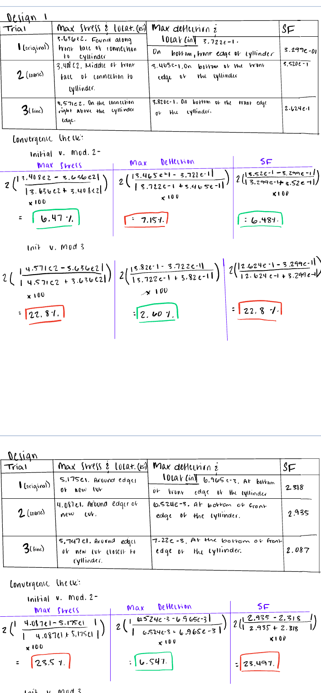
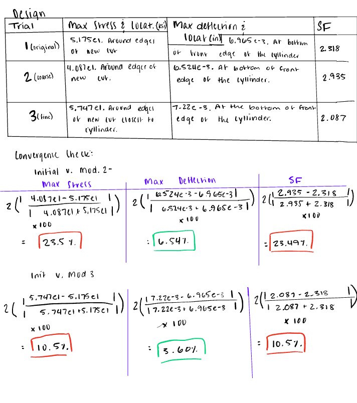
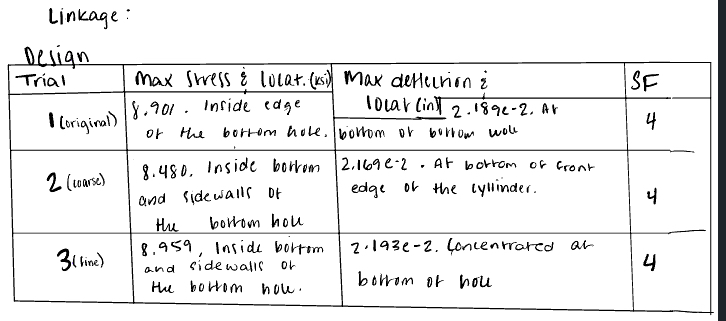
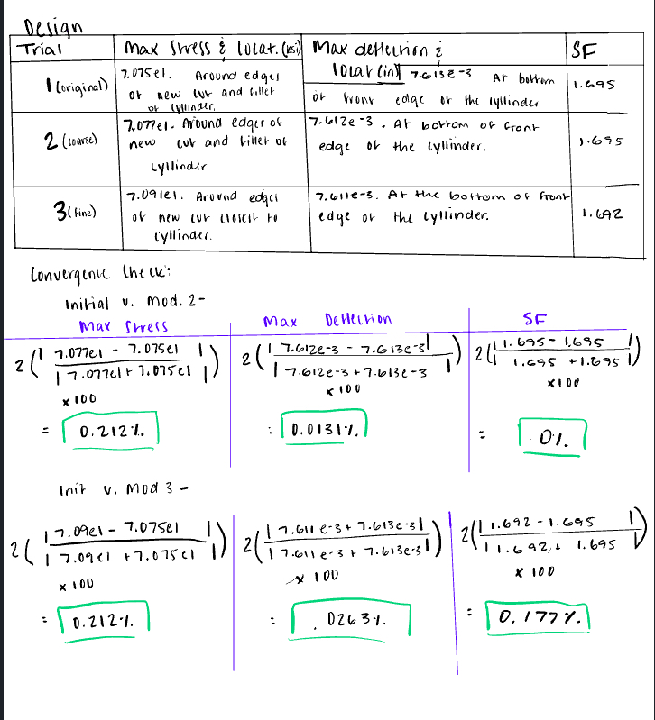
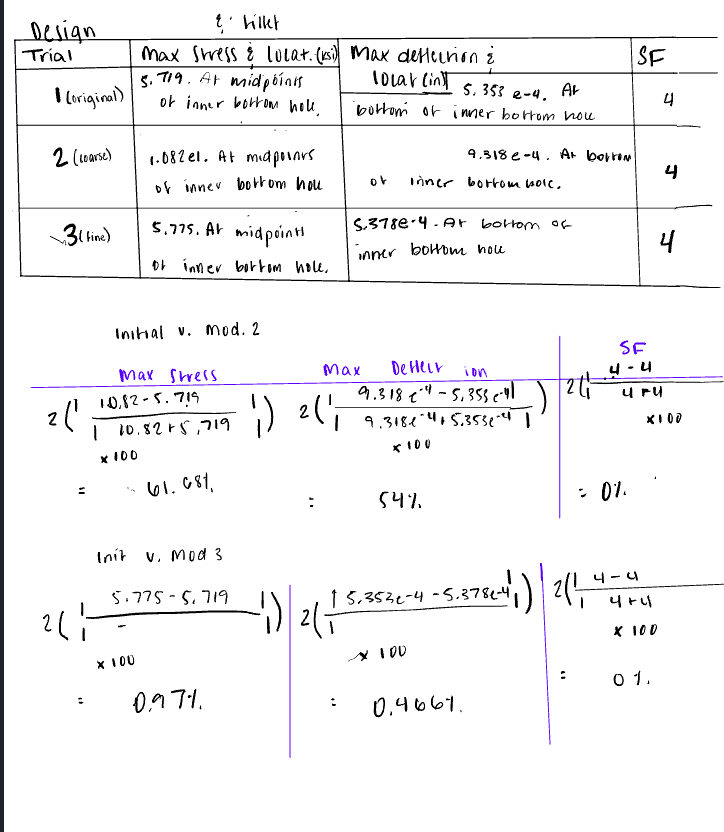
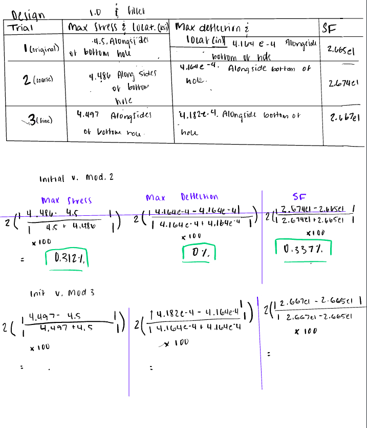

# A7 - FEA

## Objectives
  
Use Finite Element Analysis (FEA) to improve the bracket design from previous assignments.
Ensure high stiffness, strength, and lightweight optimization through iterative design.
Conduct multiple FEA simulations, refining geometry based on results.
Perform static stress analysis, including constraints, loading, and meshing selection.
Interpret data by identifying max stress, displacement, and safety factors.
Optimize the design by modifying geometry to enhance performance.
Document the entire process with images, calculations, and insights.
Reflect on key engineering lessons learned and time spent.
  
## Analyzing Bracket
  
To optimize the bracket design from previous assignments, I began by setting functioning parameters, in this case the applied force and t-bracket fixture, to my previous model. During this set up I applied my material and analyzed the existing design, and noting the maximum stress, deflection, and safety factor. 
  
Within the first convergence check, I found that the grain size provided inconsistent ratios and seemed to emphasize a poor stress distribution over the design. To accommodate the geometry I began to add fillets and repeated the FEA process. These changes proved unhelpful; multiple fillets, two extrudes, and a connection piece cut were required to reach the end design, where all values were able to converge. I made these decisions to relieve stressed lying at edges and corners, increase overall surface area, and decrease mass post extrude. 
  
### Bracket Calculations
  

    

    

  

  
## Analyzing Link - Finite Element Method
  
I chose to model the link for this part as the same material to keep consistency through the models. To begin FEA, I began with the same first steps, setting the top hole as a fixture and the bottom with the force that would be applied from the bracket.
  
The initial three trials of FEA highlighted stress concentrations and high deformation within the 1-in diameter hole itself. From this, I chose to fillet the part and increase the thickness to 0.8 in form 0.5in. I did this because the ideal convergence results from my last attempt on the bracket and this should increase the surface area and relieve stress as well.
  
Despite what prior results may have suggested, I was surprised to see the results were not as expected for the changes I had made. Although the medium and fine mesh data was able to converge, I considered the lecture last held for this course. In that time, I was exposed to the idea that elements of FEA may cause error if not placed correctly. It is with this knowledge in mind that I continued to make design choices which would increase the surface area overall by increasing thickness to 1 in.   
  
In this final static study, the last geometry change was shown to lessen all values tracked within the inner loop (maximum stress and deflection and the safety factor.) Resulting in full convergence from the medium and coarse mesh size data.  
  
### Link Calculations
  

  

  

    

  
## CAD Links and Lessons Learned
  
This project was my first experience using a finite element method to dictate CAD modeling. The major lesson I pulled away was the importance of organized documentation, more so than is necessary with parametric modeling for example. Without tables, color coding, or another organization system, and multiple pieces of data, it would be difficult to make a sound design decision. Beyond this, it taught me visually how easily design decisions can change the state of the part and therefore, its ability to function. This lesson demonstrated the variation that can be seen across mesh sizes and highlighted the importance of comparing results from multiple.
  
**To download the final models of the project discussed, follow this link:** https://drive.google.com/file/d/1uugeZMiW2QJU6RH_jnTS5mq7h0bwTtym/view?usp=sharing
