# A8 – Gears

## Objective
- Design a gearbox that can be assembled and disassembled.
- Analyze and size input and output shafts for strength.
- Design journal bearings to support shafts.
- Create a gearbox housing with proper clearance and fastening.
- Use parametric CAD modeling to generate a final design.
- Document calculations, sketches, and lessons learned.
  
## Analyze
  
To begin the design of the shafts I started by finding the ideal values for the Pinions Torque and speed. As the pinion acts as the input for this system, the power acting on it acts on the gear as well. I used the found speed to determine the value of the power acting throughout.
  
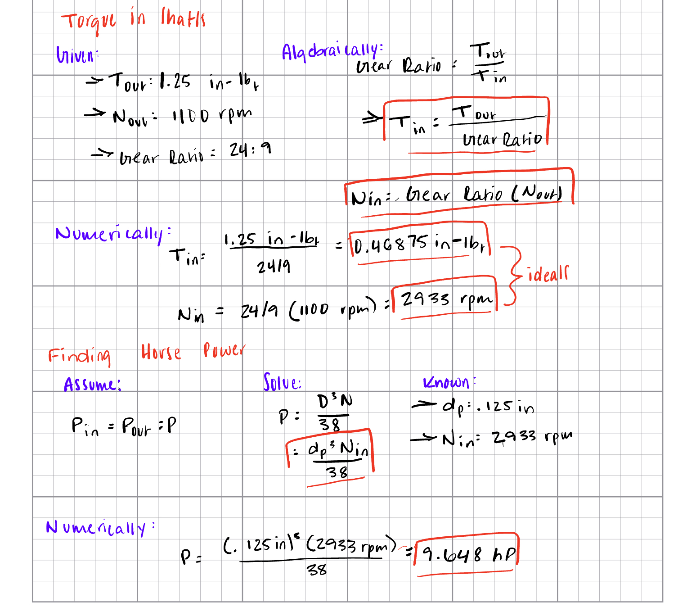
  
### Design of the Shafts
  
**Power Transmission**
Once ideals were found, they are used to determine the shear stress that develops in the input shaft. To set up the equation for the value, the section modulus is found as well. This value is then compared to the allowable torsional shearing stress for small, short shafts found within the Machinery's Handbook. (pg. 289)
   
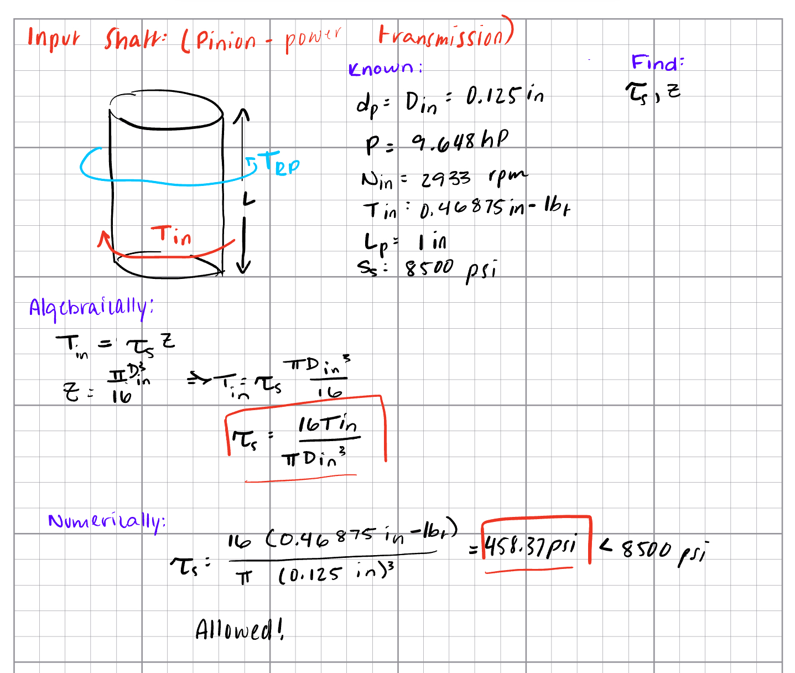
  
Because the stress found is far below the allowable stress, the shaft diameter is sufficient.
  
**Short Shaft**
The same procedure is followed to find the shear stress within the output shaft, instead using given values for the Gear. 

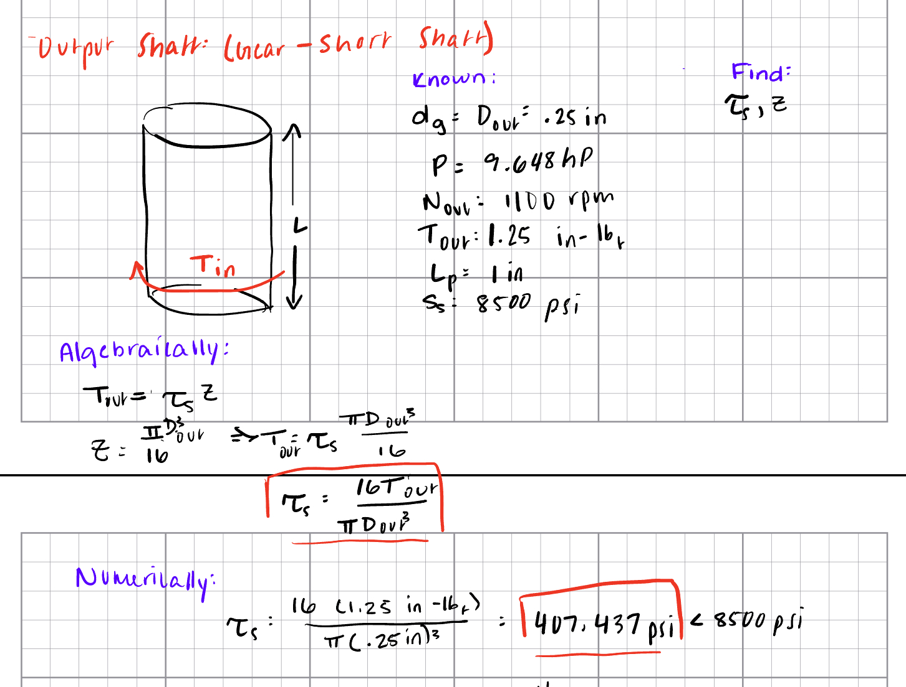
  
The stress for this shaft was below the allowable stress as well, so the diameter is kept as is.
  
### Design Journal Bearings
  
**Determine Material**
  
In order to design the bearings, the pressure, speed and PV limit must be determined to find the material limitations. This is found using the tangential and rotational force acting on the gears. These values reveal material limitations, which are needed to find diameter and length.
  
I began with analysis of the input Bearing, which is connected to the input shaft. Meaning, the speed at the input of the pinion is equivalent to the velocity of the bearing. Needed values are calculated using the following formula set up.

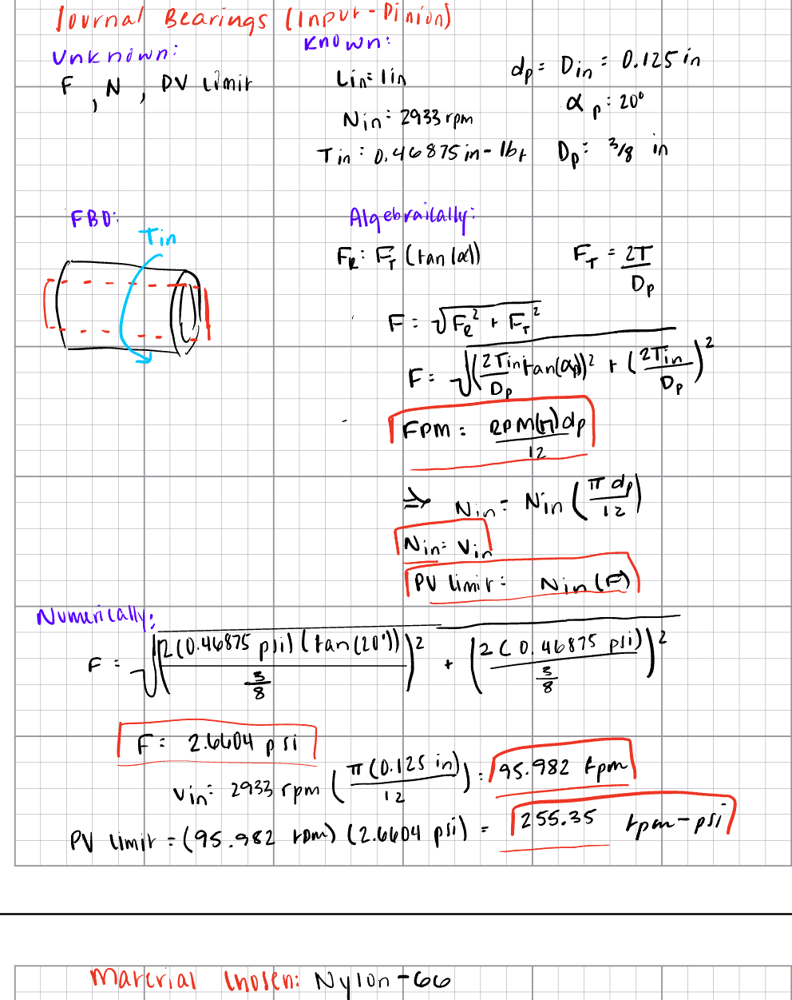
  
Using the Machinery Handbooks Application Limits of Plain Bearing Materials, I chose Nylon as the material for this bearing. (pg. 2442)
  
  
The process stated for the input bearing is used to determine the necessary values for the output bearing. Nylon was chosen for this bearing as well to keep consistently throughout the design.

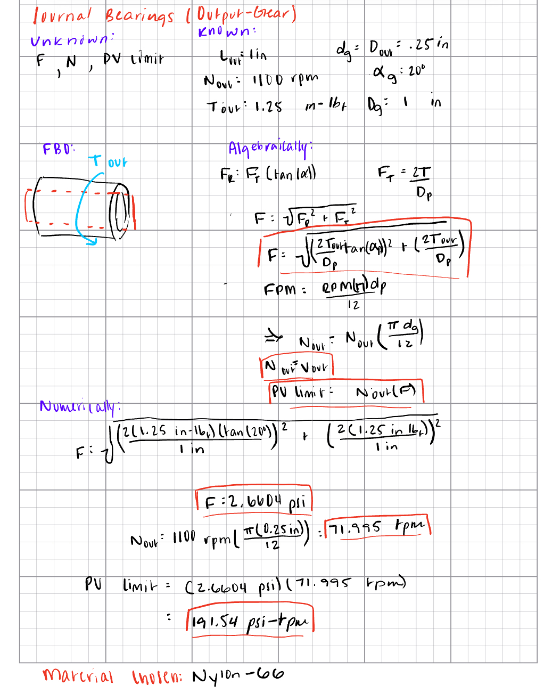

   
**Designing Size and Length of Journal Bearing**
  
For this design I chose an RC4 or Close Running fit for the shafts because accurate location and moderate journal bearing pressures are required. I chose to use a +.0009 in clearance from the Handbooks chart. (pg. 654)
  
This clearance was added to the given diameter of the shafts to be used as the inner diameter minimum for each journal bearing. First, I did this for the input bearing and then the output bearing.
  
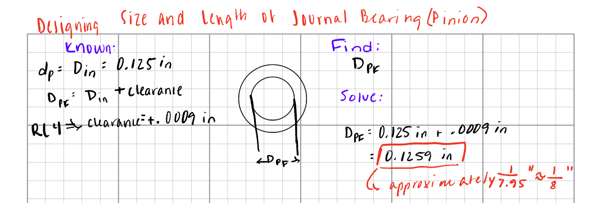
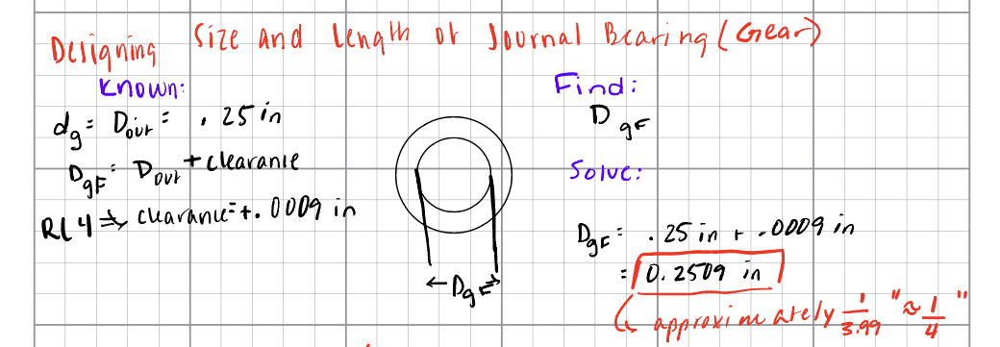
    
  
### Design Thickness of the Journal Bearing
  
The last unknown minimums remaining are the thickness of each journal bearing. This is found by using the allowable yield tensile strength, found inner diameter, and pressure applied. These values are used below to calculate for both the input and output bearing
    
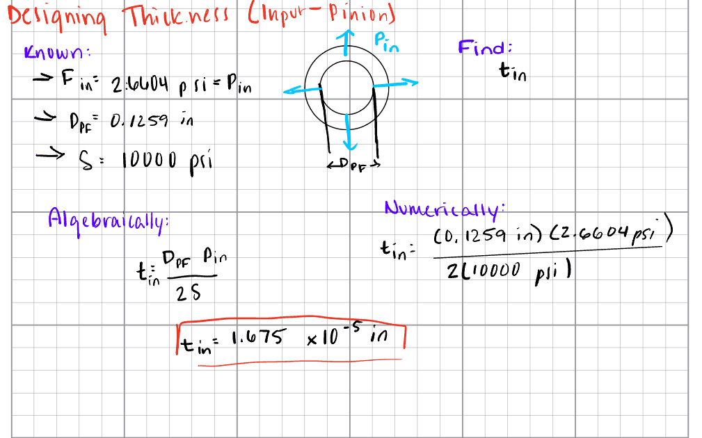
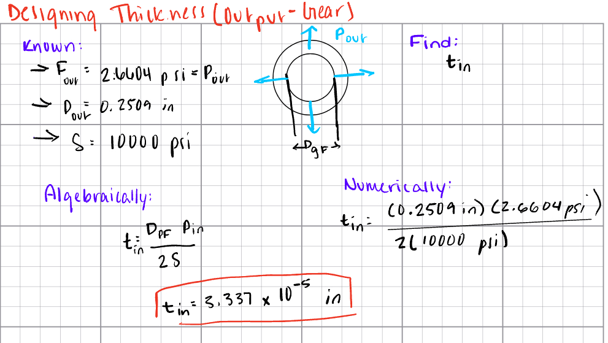
   
### Choosing McMaster Parts
  
Using the McMaster link provided through Canvas, I was able to filter the bearings to the closest rounded up known measurements. From those results, I chose bearings which could remain otherwise similar in dimension for consistency in the final model. Resulting from this filter, I determined an output bearing at 1/4" diameter and 1/4" length and a 1/8" diameter and 1/4" length input bearing is most ideal based on found measurements.
  
**Input Bearing:** Dry Running Nylon Sleeve Bearing (6389K1)
  
**Output Bearing:** Dry Running Nylon Sleeve Bearing (6389K352)
  
Resources:
-  https://www.mcmaster.com/6389K352/
-  https://www.mcmaster.com/6389K1/

### Sketch of Gearbox Housing

## CAD Model - Gearbox
  
To begin the CAD model, I started with one half of the gearbox. I input inner and pitch diameters within the global equations. I used these measurements to create tangent circles which will be used to create the center lines, directing the shaft/bearing holes. There is clearance between the intended pitch diameters and the walls of the design to avoid friction. 
  
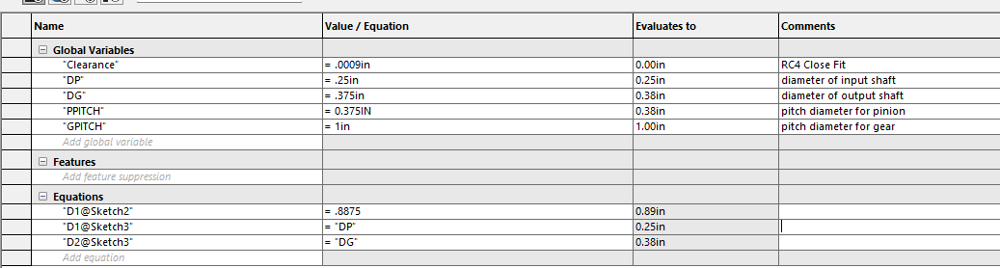
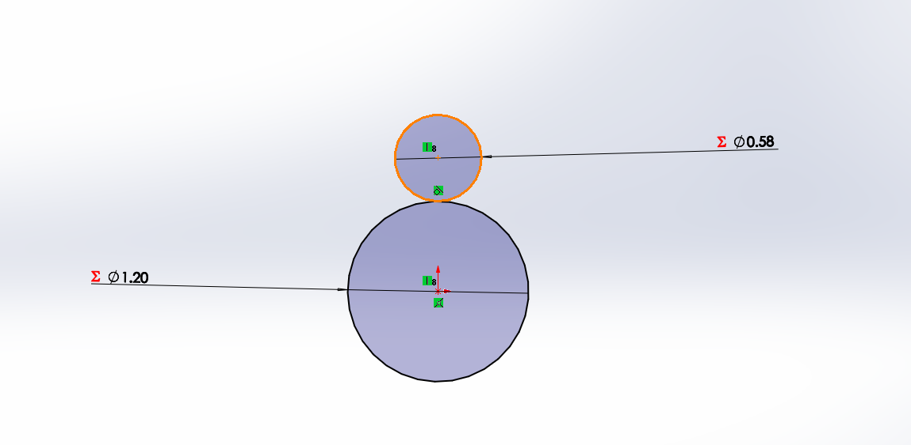
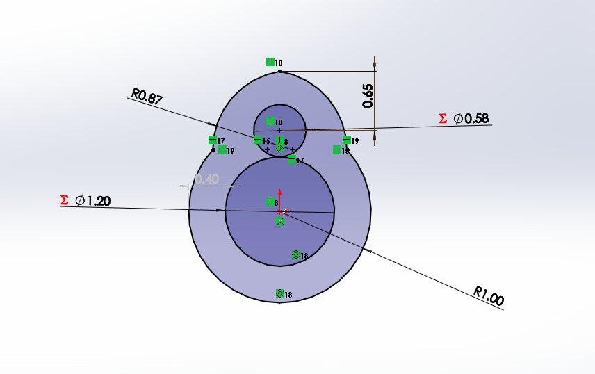
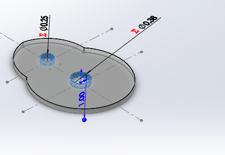
  
  
A lip which lessons the surface of contact of the gear teeth to the body of the gear box is added with the same goal in mind. Lastly an extending thinner edge is added to the model alongside pin holes as the intended closure mechanism for the design.
    
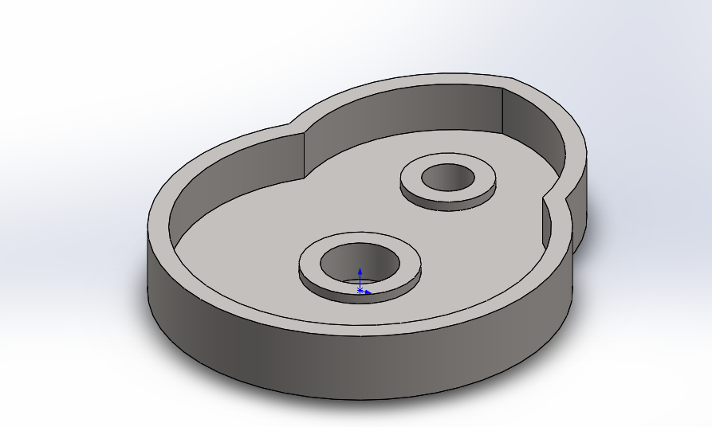
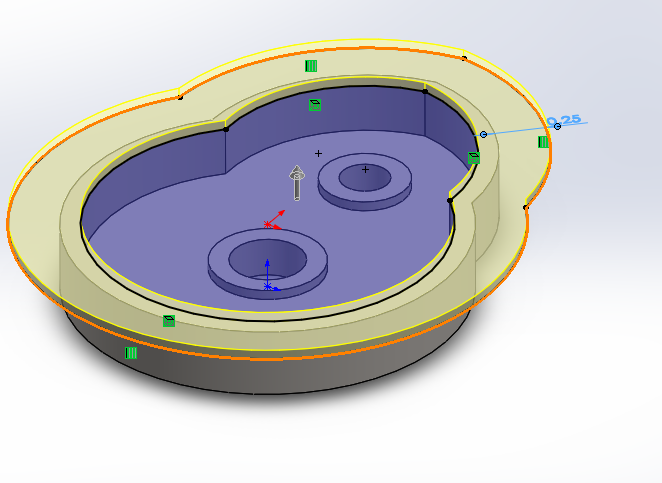
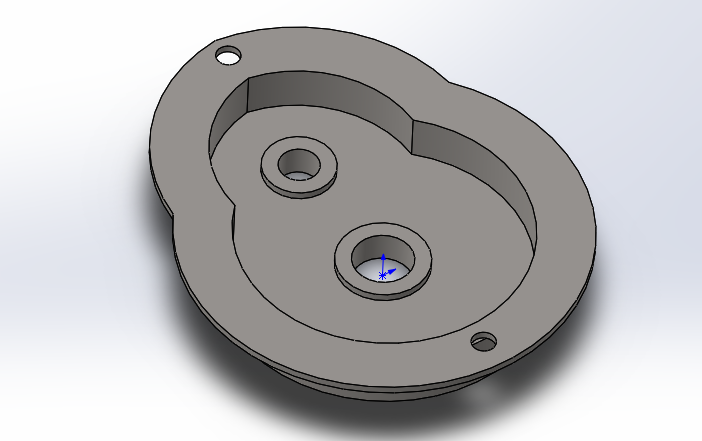
  
Next, I saved a copy of that existing half, and removed the shaft/bearing holes from the model. This acts as the second closed half of the box. 
  
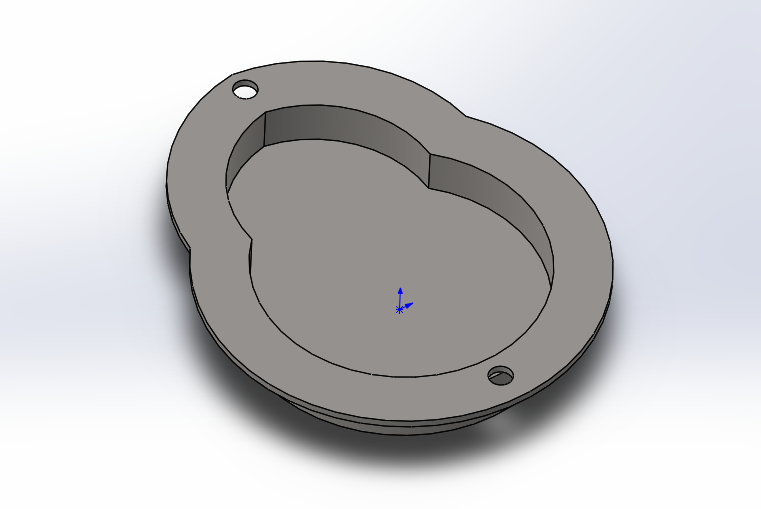
  
Then, I created a new global equation table for a shaft model, ensuring to add the found diameters for both. I modeled one at a time using the same technique of reusing a copy of the model, this time changing the value assignment for the diameter. 
  
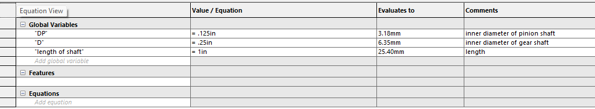
  
The modeling process is concluded with a final assembly which includes the bearings chosen and the gears given for the assignment. During this assembly, I realized a small repair would be needed to the sketch, as I added the clearance I intended for the walls to the distance between gears instead.

_Repair:_  
  
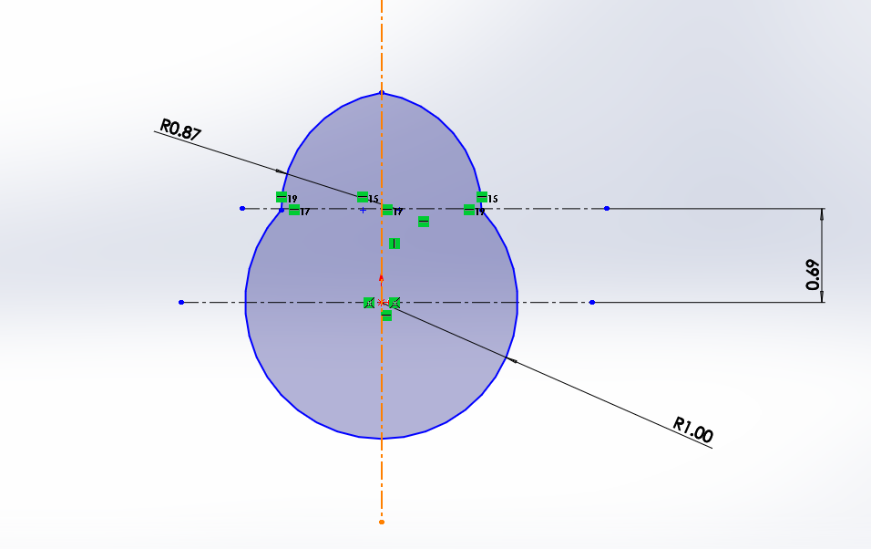
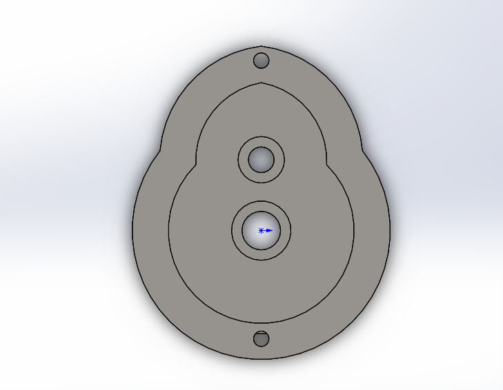

_Final Assembly:_
  
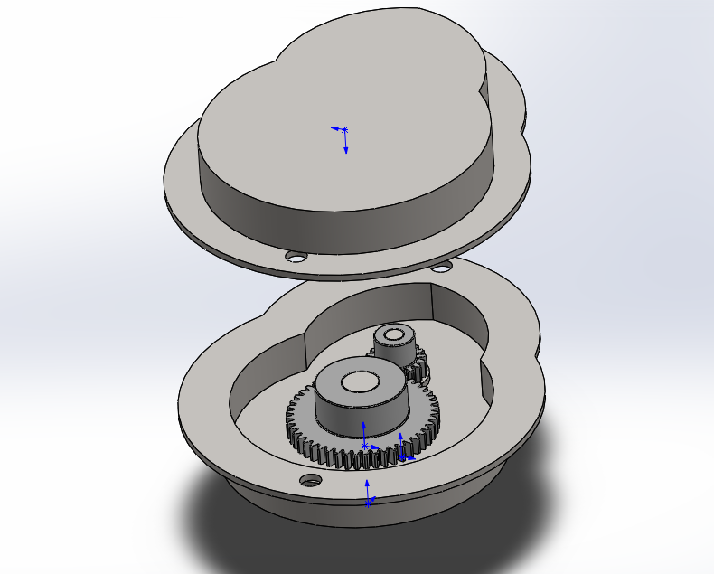
  
  
## Drawings

## Lessons Learned
  
This assignment brought to my attention the intricacy of seemingly simple designs. A main lesson I will takeaway is the importance of considering all elements which will affect a design and how those elements interact or determine each other. Before this, I did not have an understanding of how gears are used to transfer power through mechanical structures using shafts.
  
This assignment took a total of 13 hours. 
  
## Resources and Files
   
**Resources:**  
  
-  https://www.mcmaster.com/6389K352/
-  https://www.mcmaster.com/6389K1/
-  https://www.aiplastics.com/media/amari/datasheets/Nylon-66%20Datasheet.pdf
-  https://drive.google.com/file/d/0B_9_QFV-DZ-yeS1wdE1jTXZ0RDQ/view?resourcekey=0-yk9DIEwAd5PoV_KUHUflqg
  
**Download My Files:**  
https://drive.google.com/drive/folders/1DXUQTYHNJb_Bh53hnbBHslK1wRyabdKq?usp=sharing

