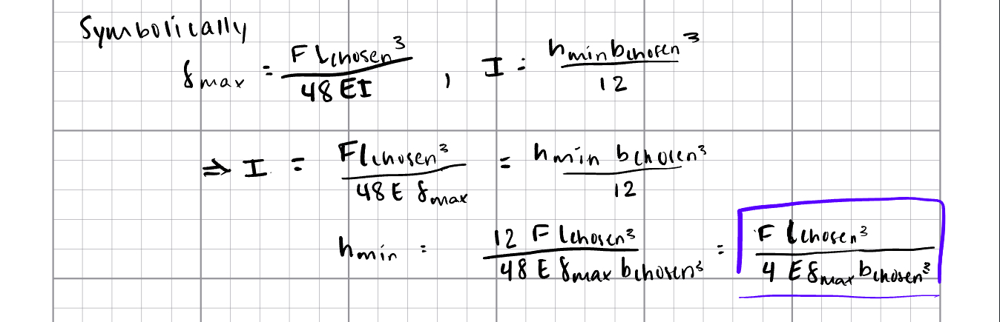
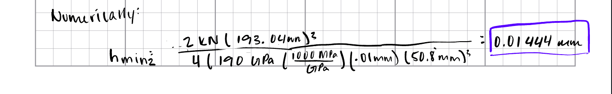

# A10 – Lead Screw Translating System

## Objective

## Design the Crosshead
### Research
  
Before beginning analysis, I researched existing bench-top footprint tensile testing machines and the given load cell to determine the length of the crosshead. The main issue of the area or size of the head is ensuring all parts have room to fit and function on the part. To do this, I found the sum of the two nut flange diameters and the width of the cell to find the length if each part was tangent each other. Then, using a sketch, I chose gap distances between the part. This total was my chosen length.
  
Since the nut flange was found to be 1.6 inches, I used that diameter as the minimum base measurement for the crosshead. Since it is a minimum, and FEA is to be conducted later, I chose to dimension the design for part at 2 inches instead.
  
Lastly, I chose 1090 Steel as it is a tool steel with high strength and should result in a durable part.

Resources:

### Beam Stress/Strength Analysis
  
The only dimension left unknown is the minimum height, or thickness, of the crosshead. To determine this I conducted a Beam Stress and Strength Analysis assuming the lead screws act as supports. In these calculations, the relationship between stress, yield strength, and section modulus are used to determine the unknown measurement.
   
Once the final formula has been found symbolically, numbers are input and the value is solved numerically.
  
**Visuals:**  
  

  
### Beam Deflection Analysis
  
Next, beam deflection analysis is conducted to compare the results to the first found value. It can be noted that the Yung's Modulus of 1090 Steel is added to the list of known values in GPa. I chose to do the calculations for this analysis using metric dimensions because the given maximum deflection to be used, 0.01mm, is a much smaller magnitude once converted. Chosen measurements are converted as well for the same reasons.
  
Here, the relationship between that maximum deflection, the Yung's Modulus, and the moment of inertia are used to find the unknown measurement. Once found numerically, it is clear that the first found measurement is the true minimum. 

**Visuals:**  

  
### Final Height Chosen
    
These dimensions are fairly low due to the choice to use a very strong steel, so I chose the height at one inch. This choice makes the part more realistic to manufacture.  
    
  
  
### Initial Paper Drawing

## Analyze

## Decide
_Reference your concept selection (Pugh matrix) here. How does this design follow from that decision?_

## Communicate

